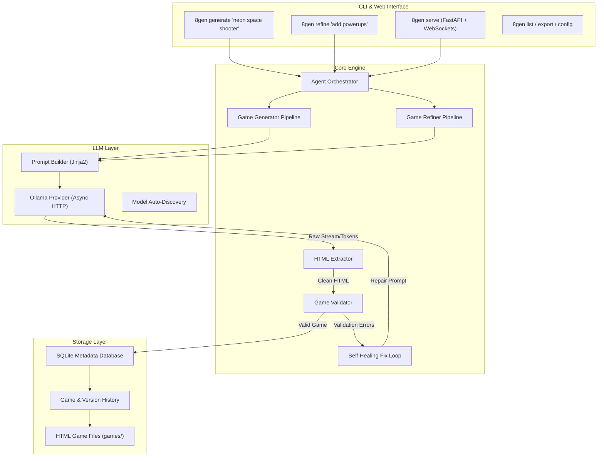

# 🎮 8Gen — Instant AI Game Generator

> **Autonomous AI Agent that crafts complete, playable HTML5 games locally in seconds using Ollama.**

[](https://www.python.org/)
[](LICENSE)
[](https://ollama.com/)

8Gen is a fully modular, production-ready AI agent that converts your game ideas into instant, playable single-file HTML5 games running entirely on your local machine with zero external cloud dependencies or API keys.

---

## ✨ Key Features

- **100% Local & Offline**: Powered by local LLMs via Ollama (Qwen 2.5 Coder, Llama 3.1, DeepSeek Coder, CodeLlama, etc.). No subscriptions or API keys needed.
- **Zero Dependencies for Games**: Games are generated as self-contained HTML5 single files with embedded CSS and vanilla JavaScript using Canvas 2D and the Web Audio API for retro sound synthesis.
- **Self-Healing AI Loop**: Generated games are automatically validated for structure, game loops, canvas containers, and interactivity. If any issues are detected, 8Gen's debugger loop automatically repairs the code before saving.
- **Game Versioning & Refinement**: Iterate on your games using simple prompts (`8gen refine last "add power-ups and laser sound effects"`). Every iteration is tracked in SQLite.
- **Web Dashboard & Arcade Gallery**: Built-in FastAPI web dashboard with arcade gallery, in-browser play in sandboxed iframes, fullscreen mode, live WebSocket token streaming, and one-click export.
- **Rich CLI**: Beautiful interactive terminal output with progress indicators, formatted tables, game cards, and diagnostic checks.
- **Extensible Architecture**: Layered design with CLI, Core Engine, LLM Provider Abstraction, Jinja2 Prompts, SQLite Storage, and a Plugin Hook system.

---

## 🏗️ Architecture



---

## 🚀 Quick Start

### 1. Prerequisites
- **Python 3.9+**
- **[Ollama](https://ollama.com/)** running locally

Ensure you have a code-capable model pulled in Ollama:
```bash
ollama pull qwen2.5-coder:7b
# or
ollama pull llama3.1
```

### 2. Installation
Clone the repository and install dependencies:
```bash
git clone https://github.com/your-username/8Gen.git
cd 8Gen

# Create virtual environment
python3 -m venv .venv
source .venv/bin/activate

# Install 8Gen in editable mode
pip install -e .
```

### 3. Verify Setup
Run the diagnostic check to verify Ollama connectivity:
```bash
8gen config check
```

---

## 🕹️ CLI Usage

### Generate a Game
```bash
# Generate and immediately play in default browser
8gen generate "retro space shooter with laser powerups"

# Specify a category
8gen generate "dungeon crawler with enemies and loot" --category action

# Use a specific model
8gen generate "cyberpunk flappy drone" --model huihui_ai/qwen2.5-coder-abliterate:7b

# Generate without auto-opening browser
8gen generate "brick breaker with multiball" --no-open
```

### Refine & Iterate on an Existing Game
```bash
# Refine the most recently created game
8gen refine last "add a high-score counter and explosion particles"

# Refine a specific game by ID
8gen refine abc12345 "make enemies shoot lasers back at the player"
```

### Browse Your Library
```bash
8gen list
8gen list --tag shooter
```

### Launch Web Dashboard
```bash
8gen serve
# or on custom port:
8gen serve --port 9000
```
Open [http://localhost:8000](http://localhost:8000) to browse your gallery, play games in full screen, generate new games with live token streaming, and refine them.

### Export Game File
```bash
8gen export last --output ~/Desktop/my_game.html
```

---

## ⚙️ Configuration

8Gen uses layered configuration with the following priority:
**CLI Flags > Environment Variables > TOML Config File (`8gen.toml`) > Defaults**

You can configure settings via `.env` file or environment variables:
```bash
EIGHTGEN_OLLAMA_URL=http://localhost:11434
EIGHTGEN_MODEL=huihui_ai/qwen2.5-coder-abliterate:7b
EIGHTGEN_OUTPUT_DIR=./games
EIGHTGEN_DB_PATH=./games/8gen.db
EIGHTGEN_SERVER_HOST=127.0.0.1
EIGHTGEN_SERVER_PORT=8000
EIGHTGEN_AUTO_OPEN=true
EIGHTGEN_TEMPERATURE=0.7
EIGHTGEN_MAX_RETRIES=3
```

View active settings anytime:
```bash
8gen config show
```

---

## 🧪 Running Tests

8Gen comes with an automated test suite covering unit tests, mocked agent pipelines, HTML extraction, validation checks, and Ollama integration tests.

```bash
pytest tests/ -v
```

---

## 📂 Project Structure

```
8Gen/
├── pyproject.toml                  # Python package configuration and CLI entry points
├── Makefile                        # Development automation commands
├── README.md                       # Documentation
├── .env.example                    # Environment template
│
├── src/
│   └── eightgen/                   # Core Python package
│       ├── cli/                    # Click-based CLI commands & Rich display
│       ├── core/                   # Agent orchestrator, generator, refiner, validator
│       ├── llm/                    # Ollama provider, prompt builders, model registry
│       ├── prompts/                # Jinja2 prompt templates (system, user, debug, examples)
│       ├── templates/              # HTML5 starter skeletons & registry
│       ├── storage/                # SQLite database, models, and game repository
│       ├── server/                 # FastAPI dashboard, REST API, WebSockets, gallery UI
│       ├── plugins/                # Extensible plugin lifecycle hooks
│       ├── config/                 # Pydantic settings & TOML loader
│       └── utils/                  # Structured logger, slugifier, browser launcher
│
├── tests/                          # Automated test suite
│   ├── conftest.py
│   ├── unit/                       # Unit tests for core, storage, prompts, validator
│   └── integration/                # Integration tests for local Ollama
│
└── games/                          # Generated HTML5 games and SQLite database
```

---

## 📄 License
MIT License. Created for local autonomous game synthesis.
